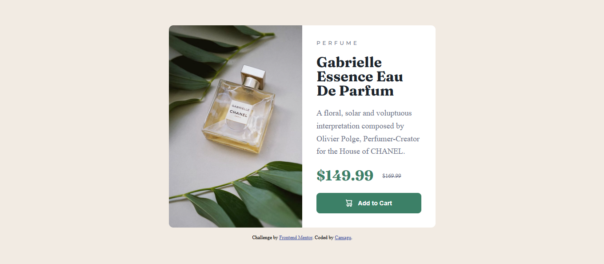

# Frontend Mentor - Product preview card component solution

This is a solution to the [Product preview card component challenge on Frontend Mentor](https://www.frontendmentor.io/challenges/product-preview-card-component-GO7UmttRfa). Frontend Mentor challenges help you improve your coding skills by building realistic projects.

## Table of contents

- [Overview](#overview)
  - [The challenge](#the-challenge)
  - [Screenshot](#screenshot)
  - [Links](#links)
- [My process](#my-process)
  - [Built with](#built-with)
  - [What I learned](#what-i-learned)
  - [Continued development](#continued-development)
- [Author](#author)

**Note: Delete this note and update the table of contents based on what sections you keep.**

## Overview

### The challenge

Users should be able to:

- View the optimal layout depending on their device's screen size
- See hover and focus states for interactive elements

### Screenshot



### Links

- Solution URL: [ https://camagu-mgadle.github.io/Product-preview-card-component](https://camagu-mgadle.github.io/Product-preview-card-component/)
- Live Site URL: [Add live site URL here](https://your-live-site-url.com)

## My process

### Built with

- For markup used Semantic HTML5 structure:
  - main
    - article
  - footer
- Mobile-first workflow
- Flexbox Model
- Google fonts
  - Family: [Montserrat](https://fonts.google.com/specimen/Montserrat)
    - Weights: 500, 700
  - Family: [Fraunces](https://fonts.google.com/specimen/Fraunces) - Weights: 700
    -- CSS custom properties:
    @media quiry

### What I learned

- Used an article element as a container instead of asimple div.
- Used a picture element for the main images:
  ```html
  <picture>
    <source
      srcset="./images/image-product-desktop.jpg"
      media="(min-width: 48em)"
    />
    
  </picture>
  ```
- media query for mobile breakpoints:

  ```css
  .card-container {
    max-width: 21.25rem;
    display: flex;
    flex-direction: column;
  }
  .main-section {
    padding: 1.5rem;
  }
  @media (min-width: 48em) {
    .card-container {
      max-width: 37.5rem;
      display: grid;
    }

    .main-section {
      padding: 2rem;
    }
  }
  ```

### Continued development

- Understanding how to use HTML5 attributes for more accessible web content.
- For accessibility learn more about css attributes like aria-labeledby.
- Learn more about CSS Frameworks.

## Author

- Website - [Camagu](hhttps://mgadleca.netlify.app/)
- Frontend Mentor - [@camagu](https://www.frontendmentor.io/profile/camagu)
- LinkedIn - [@camagu](https://www.linkedin.com/in/camagu-mgadle/)
